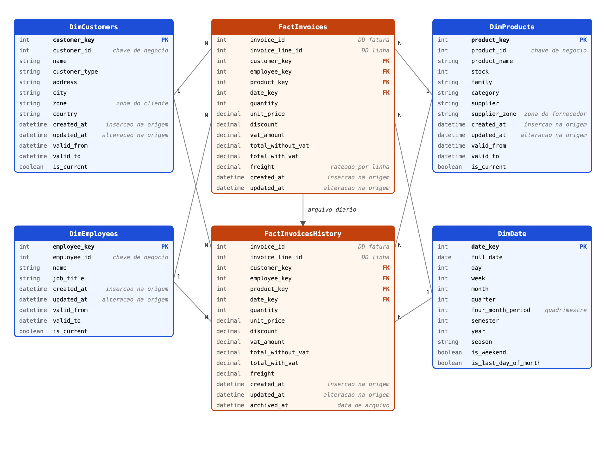

# ARMDD_26-27_1260527_1211883

Data mart de vendas (faturação) da More Rhythm, SA — Armazéns de Dados, Mestrado em Engenharia Informática (ISEP), 2026-2027.

## Metodologia Kimball

### 1. Processo de negócio
Vendas (faturação) a clientes, efetuadas pela More Rhythm, SA .

### 2. Granularidade (grain)
Uma linha da tabela de factos por **linha de fatura** (produto vendido a um cliente, numa fatura emitida por um funcionário). 

### 3. Dimensões

| Dimensão | Atributos / hierarquias | Estratégia SCD |
|---|---|---|
| `DimCustomers` | cliente, tipo de cliente; cidade, zona, país | Misto (Tipo 1 e 2) |
| `DimEmployees` | funcionário, cargo | Misto (Tipo 1 e 2) |
| `DimProducts` | produto, família, categoria, fornecedor, zona do fornecedor | Misto (Tipo 1 e 2) |
| `DimDate` | dia, semana, mês, trimestre, quadrimestre, semestre, ano; estação, fim-de-semana, último dia do mês | Tipo 0 (estática) |

#### Estratégia SCD por atributo

- **Tipo 0:** nunca altera.
- **Tipo 1:** sobrescreve o valor, sem histórico.
- **Tipo 2:** fecha a linha atual e cria uma nova versão com nova chave substituta.

| Dimensão | Atributo | SCD | Justificação |
|---|---|---|---|
| `DimCustomers` | `customer_id` (chave de negócio) | Tipo 0 | Identificador fixo; usado para detetar alterações |
| | `name` | Tipo 1 | Correções de escrita; não afeta as análises |
| | `address` | Tipo 1 | Não é usada em nenhuma análise |
| | `customer_type` | Tipo 2 | Análises por tipo de cliente devem manter o tipo da data da venda |
| | `city` | Tipo 2 | Análises por cidade do cliente |
| | `zone` | Tipo 2 | Análises por zona do cliente |
| | `country` | Tipo 2 | Vendas em Portugal e Espanha |
| `DimEmployees` | `employee_id` (chave de negócio) | Tipo 0 | Identificador fixo |
| | `name` | Tipo 1 | Correções de escrita |
| | `job_title` | Tipo 2 | Preserva o cargo do funcionário na data da venda |
| `DimProducts` | `product_id` (chave de negócio) | Tipo 0 | Identificador fixo |
| | `product_name` | Tipo 1 | Correções de escrita |
| | `stock` | Tipo 1 | Muda com frequência; só o valor atual interessa |
| | `family` | Tipo 2 | Reclassificação não deve alterar vendas antigas |
| | `category` | Tipo 2 | Reclassificação não deve alterar vendas antigas |
| | `supplier` | Tipo 2 | Preserva o fornecedor da data da venda |
| | `supplier_zone` | Tipo 2 | Análises por zona do fornecedor |
| `DimDate` | todos os atributos | Tipo 0 | Dimensão estática, gerada de uma vez |

Duplicados de clientes (exatos ou aproximados) são resolvidos na limpeza, antes de aplicar o SCD, com uma tabela de correspondência `id_origem` para `id_mestre` na staging.

Colunas de auditoria e histórico:
- O sistema operacional regista a data e hora de inserção e de cada alteração de atributos. Estas datas são copiadas para `created_at` e `updated_at` em todas as dimensões (exceto `DimDate`) e nas tabelas de factos, e servem de critério para a carga incremental.
- As dimensões com SCD Tipo 2 têm ainda `valid_from`, `valid_to` e `is_current` para guardar as versões históricas de cada registo.

### 4. Factos / Medidas

Tabela de factos transacional (`FactInvoices` com os registos do dia e `FactInvoicesHistory` com os anteriores).

| Medida | Aditividade |
|---|---|
| `quantity` | Aditiva |
| `total_without_vat` | Aditiva |
| `vat_amount` | Aditiva |
| `total_with_vat` | Aditiva |
| `freight` (rateado por linha) | Aditiva |
| `unit_price`, `discount` | Não aditivas (usar médias ou valores calculados) |

Dimensões degeneradas: `invoice_id`, `invoice_line_id`.

## Modelo dimensional

## Notas de desenho
- `FactInvoices` guarda apenas os registos do dia; no início de cada carga, as linhas de dias anteriores são movidas para `FactInvoicesHistory` (numa só transação).
- As análises devem ler uma view `vwFactInvoicesAll` (`UNION ALL` das duas tabelas), para manter a granularidade mais elementar.
- A carga incremental verifica o `invoice_line_id` nas duas tabelas.
- Os atributos apresentados são uma proposta e devem ser ajustados ao esquema da base de dados operacional.
